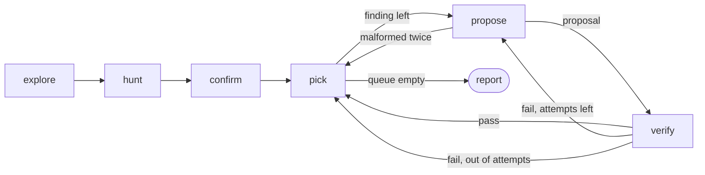

# LedgerAgent

A LangGraph agent that audits a synthetic legacy ERP in Postgres, finds data discrepancies in the general ledger and accounts payable, and suggests fixes that a deterministic verifier has checked. It never applies a fix.

## Results

Results are pending. No measured numbers are published yet, and none are estimated here. The first recorded run will replace the placeholder below with the holdout table, misses included.

### Measured results (placeholder, replaced by the first recorded run)

| Metric | Holdout |
| --- | --- |
| Recall | pending |
| Precision | pending |
| Decoy false alarm rate | pending |
| Fix validity | pending |
| Verified but wrong | pending |
| End-to-end fix rate | pending |
| Needs human rate | pending |
| Tokens, cost and queries per run | pending |

The one result that exists today is the guardrail suite: the verifier must refuse 100% of its deliberately bad fixes, and the suite exits non-zero if it does not. That figure covers only that suite, which has no LLM and does not measure the agent.

## How the agent is wired



## Run it

```bash
docker compose up --build --abort-on-container-exit --exit-code-from evals
```

This needs Docker and no API key. Every setting has a test default in `docker-compose.yml`, so no `.env` is required. To change a value, run `cp .env.example .env` and edit it. The role passwords are also fixed in `db/init/01_roles.sql`, so change both together.

Services start in this order:

1. `db` starts Postgres and becomes healthy.
2. `seed` loads scenario `dev-1` into `ledger_dev_1` and writes its answer key to a volume that only `seed` mounts.
3. `agent` audits `ledger_dev_1` and writes a Markdown and JSON report to `./out`.
4. `evals` runs the guardrail suite, then every scenario, and writes results to `./out/evals`.

`seed` and `agent` idle after they succeed, because `--abort-on-container-exit` stops the whole stack as soon as any container exits, even with code 0. A failure exits non-zero and stops the run.

Run the tests with `docker compose run --rm tests pytest`.

### Default runs are replays

The model client has three modes, set with `LEDGER_LLM_MODE`:

- `replay` (the default): answers come from recordings in `recordings/`. No API key and no network.
- `record`: calls the model and writes each response to `recordings/`.
- `live`: calls the model and records nothing. Needs `ANTHROPIC_API_KEY`.

A recording is keyed by a hash of the model, messages and tools. A request with no recording fails loudly with a missing-recording error. There is no fallback to a live call. Changing a prompt means re-recording.

A replay proves that the pipeline, the verifier and the scoring work end to end and give the same answer every time. It does not prove how the agent behaves against the real model today, and it does not prove that a changed prompt still works. The weekly live workflow exists for that.

## How it works

- `explore` reads the catalog and a short, partly wrong data dictionary, samples data, and writes schema notes including joins it infers. It uses a read-only SQL tool: single `SELECT` statements, a row cap, a timeout, and a read-only database role.
- `hunt` is given general audit principles (double-entry balance, subledger-to-GL tie-out, period controls, reference integrity, duplicates) and no table names. It returns findings, each with the SQL that proves it.
- `confirm` re-runs each finding's evidence SQL and drops any that return no rows.
- `propose` returns a structured correction, not SQL: journal lines, the journal being corrected, any invoice status change. Code renders that to parameterised SQL.
- `verify` is deterministic code. It checks structure, runs the fix in a trial transaction, checks only new correcting rows changed, applies a coded resolution rule for the fault type, then checks the whole ledger for new violations. A failure reason goes back to `propose`. Each finding gets three attempts, then goes to `needs_human`.

Two database roles keep the boundaries clear. The SQL tool uses the read-only role. Only the verifier uses the write role, and it always rolls back: the verifier never commits, and no code path does.

The fix convention is that posted entries are never edited. A fix is a new correcting journal entry that references the original, unless the problem is in non-posted data such as an invoice status.

The answer key is hidden from the agent. It lives outside the database and is never mounted in the `agent` container. A run stops at a token limit, default 200,000 tokens, and reports what it has so far.

### Evals

- The guardrail suite feeds the verifier a library of bad fixes (unbalanced groups, closed periods, inactive accounts, oversized changes, fixes that break something else) and good fixes. It must refuse every bad one at its expected check and pass every good one. No LLM is involved.
- The agent suite runs the full graph on generated ERPs: dev scenarios for tuning prompts, holdout scenarios on seeds never tuned against that supply the headline numbers, and an injection scenario that plants a hostile memo in a text field.
- Scoring is separate from the verifier. Eval code checks each fix against the answer key, so a fix the verifier accepted can still be scored wrong. That count is reported as `verified_but_wrong`.

### Cost of the live workflow

`.github/workflows/live-evals.yml` runs weekly and on manual dispatch, with a `mode` input of `live` (the default) or `record`. `record` uploads `recordings/` as a workflow artifact for a person to review and commit. The workflow never commits anything. Its cost is bounded two ways:

- `timeout-minutes: 45` stops the job.
- Each audit stops at the 200,000 token limit. The agent and the ten eval scenarios each use a fresh client, so one run is capped at roughly 2.2 million tokens in total, before any retries of transient provider errors.

## Limitations

- The audit principles given to `hunt` overlap the five planted fault types. The agent is told to look for balance, tie-out, period and reference problems, and those are the faults that were planted. Recall here is not evidence it would find faults of a kind nobody planted.
- The verifier has coded resolution rules for five fault types only: unbalanced journal, duplicate invoice, AP-to-GL mismatch, closed-period posting, invalid account. A finding of any other type goes straight to `needs_human`.
- Verified does not mean correct. The verifier checks that a fix is well formed, contained, and resolves the fault by its own rule. It can accept a balanced fix posted to an account that is active but wrong. That is why scoring is independent and `verified_but_wrong` is reported.
- The data is synthetic, generated from a seed with planted faults and decoys. Real ledgers are messier, bigger and wrong in more ways.
- Nothing is applied. Fixes are suggestions in a report, never applied to any database, and a person has to review each one.
- Replays do not prove behaviour against the live model, as described above.
- The 100% figure belongs to the guardrail suite alone. It says the verifier refuses the bad fixes in that library, not that it refuses every bad fix.

## Possible extensions

- An `apply` step behind an approval pause, so a person can approve a verified fix and have it applied in a transaction.
- Prompt optimisation with DSPy against the scored dev set, which already provides a metric to optimise.
